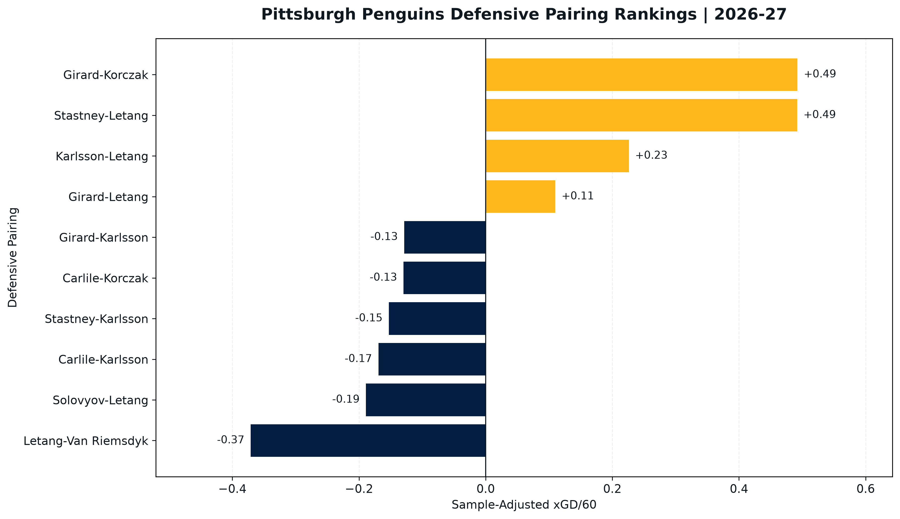
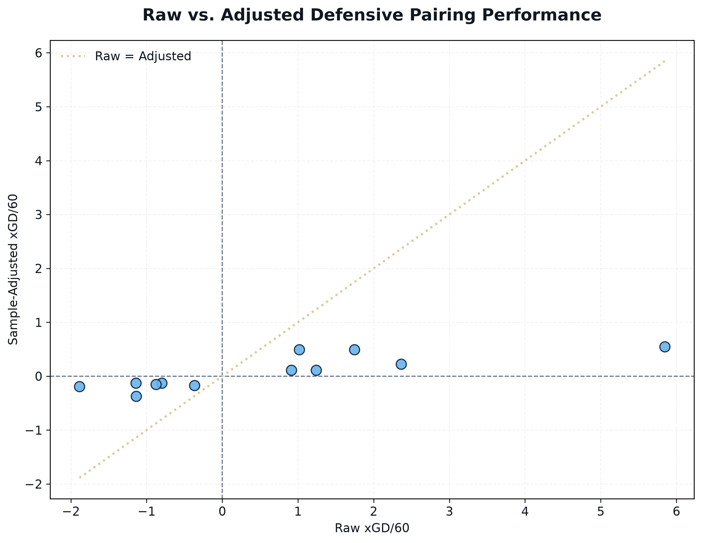
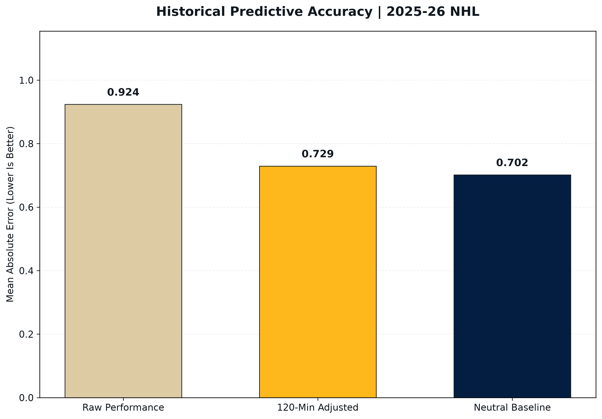

# Pittsburgh Penguins Defensive Pairing Analysis
# NHL Hockey Research & Development | Python | MoneyPuck

## Project Overview

This project evaluates Pittsburgh Penguins defensive pairings using 5-on-5 expected-goal statistics, sample-size adjustments, and historical predictive testing.

The objective is to identify defensive pairings that demonstrate strong offensive generation and defensive suppression (xGD/60) while investigating how reliably early performance predicts future results. Important to note due to the lack of data for the 2026-27 NHL season, this project will also be used to evaluate if a NHL team (Pittsburgh Penguins) can find their optimal defensive pairings 

The project uses publicly available MoneyPuck data from the 2025-26 and 2026-27 NHL seasons.

## Research Question

Can historical expected-goal differential (xGD/60) and shared ice time help identify NHL defensive pairings likely to perform effectively in future games?

## Methodology

### 1. Performance Evaluation

Three primary statistics were calculated:

- xGF/60: Expected goals generated per 60 minutes
- xGA/60: Expected goals allowed per 60 minutes
- xGD/60: Difference between xGF/60 and xGA/60

### 2. Sample-Size Adjustment

To reduce the influence of small samples, I introduced a 120-minute prior strength, representing approximately 10 games at 12 minutes of shared ice time per game.

Reliability Weight = TOI / (TOI + 120)

Adjusted xGD/60 = Raw xGD/60 * Reliability Weight

The adjustment moves observed performance toward a neutral baseline of 0.00 xGD/60.

The 120-minute parameter is an initial hockey-based assumption, not a statistically optimized value.

### 3. Historical Predictive Testing

Using 2025-26 game-by-game NHL data, I evaluated 171 defensive pairings.

For each pairing:

- First 10 qualifying games: Historical performance
- Next 10 qualifying games: Future evaluation period
- Minimum qualifying-game TOI: 180 seconds
- Primary accuracy metric: Mean Absolute Error (MAE)

I compared raw historical performance, sample-adjusted performance, and a neutral baseline.

## Historical Results

| Prediction Method | MAE |
|---|---:|
| Raw xGD/60 | 0.924 |
| 120-Minute Adjusted xGD/60 | 0.729 |
| Neutral Baseline | 0.702 |

The sample-size adjustment reduced MAE by approximately 21.1% compared with raw historical performance.

However, the neutral baseline achieved the lowest overall prediction error.

The adjusted model outperformed the raw approach for 124 of 171 pairings (72.5%) and the neutral baseline for 73 of 171 pairings (42.7%).

Historical xGD/60 had a Pearson correlation of 0.192 with subsequent xGD/60, suggesting limited predictive strength on its own.

These are exploratory results from one historical season, not independently validated future-season performance claims.

## Pittsburgh Penguins Findings

The current-season analysis identified several pairings worth further evaluation.

Girard-Korczak demonstrated a positive expected-goal differential with substantial shared ice time.

Stastney-Letang showed promising defensive suppression in a smaller sample.

Carlile-Letang recorded a strong initial differential but had very limited shared ice time, highlighting the importance of sample-size considerations.

These observations should not be interpreted as definitive lineup recommendations.

## Visualizations

### Current Defensive Pairing Rankings

### Raw vs. Adjusted Performance

### Historical Prediction Accuracy

## Limitations

- The model does not isolate individual defenseman impact.
- Opponent strength, zone starts, and teammate effects are not fully controlled.
- The 120-minute prior has not been optimized through independent validation as the best time for the model.
- The historical evaluation includes pairings with at least 20 qualifying games.
- Short evaluation windows produce various expected-goal differentials, without taking into account deployment of pairing.
- Current-season results are preliminary.

The framework is best interpreted as a sample-adjusted evaluation and historical prediction benchmark, rather than a fully validated lineup optimization algorithm. However it can be used as a starting block of evalution and pairing deployment when presented to the coaching staff. 

## Analysts Reccomendation for Pairing Deployment
The pairings below are in no particular order and are based off of the models findings combined with the authors hockey iq.
In no particular order:
- Girard & Korczak
- Stastney & Letang
- Karlsson & Carlile
These pairing produce a positive adjusted goal differential per 60 (xGD/60) of 0.81. 
This confirms that these pairings will collectivley provide a balance of offensive production, defensive supression, and complinmentary playing styles according to the analytical findings within this model. This combonation also follows the traditional pairing rule of a defesive pairing having both a right shot and left shot player in their makeup. From a coaching perspective, left-right combinations can offer advantages during defensive-zone breakouts, puck retrievals along the boards, and offensive-zone puck movement.

## Technologies

- Python
- pandas
- Matplotlib
- GitHub Codespaces
- MoneyPuck NHL Data

## Running the Project

Install the required Python libraries:

    python3 -m pip install -r requirements.txt

Run the analysis scripts in order:

    python3 explore_pairings.py
    python3 prepare_historical_games.py
    python3 create_visualizations.py

The scripts expect the source CSV files to be located in the repository's main directory.

## Data Source

MoneyPuck NHL Data:
https://moneypuck.com/data.htm

Please Note: This is an independent research project and is not affiliated with or endorsed by the Pittsburgh Penguins or the NHL.

## Author

Milan J.s Cermak

Northeastern University
Data Analytics | Hockey Research & Development

